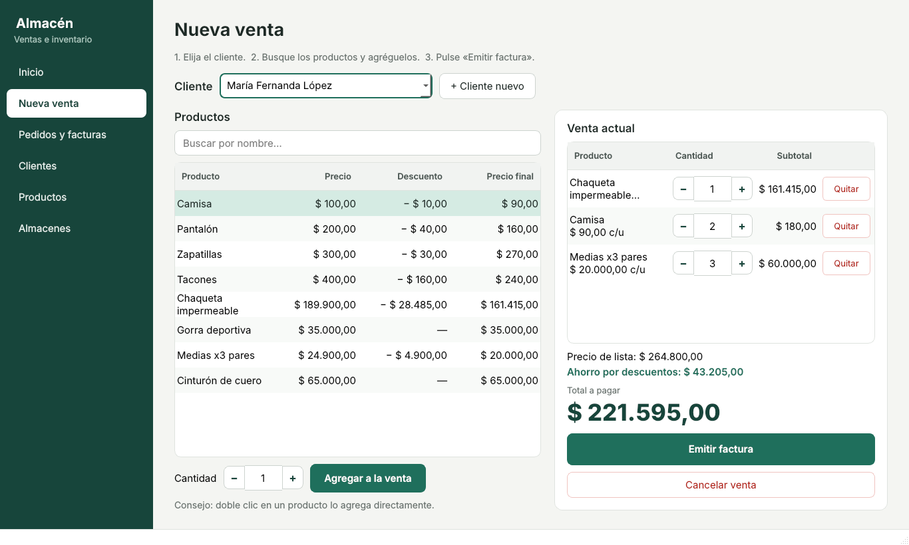
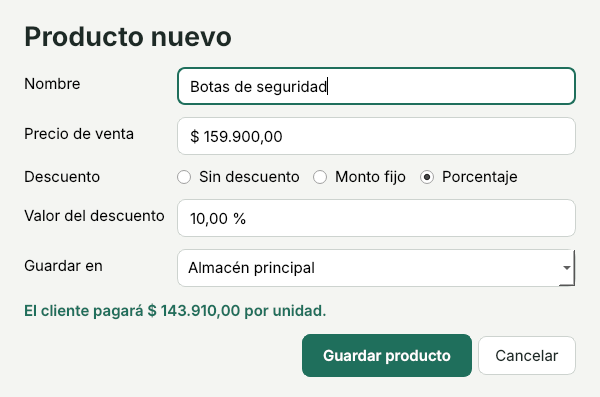

# Manual de uso

Guía para quien usa el programa en el almacén. No hace falta saber de computadores.

## Abrir el programa

Abra **`SistemaAlmacen.exe`**. A la izquierda está el menú con las seis pantallas; haga clic en la que
necesite. Abajo, la barra gris muestra lo último que pasó ("Factura N.º 3 emitida...").

**Todo se guarda solo.** No hay botón de guardar: cada cliente, producto o venta queda guardado en el
momento. Si cierra el programa o se va la luz, al abrirlo de nuevo todo sigue ahí.

## Hacer una venta

1. Entre a **Nueva venta**.
2. Elija el **cliente** en la lista. Si es nuevo, pulse **+ Cliente nuevo**, escriba su nombre y acepte.
3. Busque el producto escribiendo parte del nombre en **Buscar por nombre…**.
4. Elija la cantidad con **−** y **+** y pulse **Agregar a la venta**. También puede hacer doble clic en
   el producto.
5. A la derecha se ve la venta: puede cambiar la cantidad de cada producto o pulsar **Quitar**. El
   **Total a pagar** y el **Ahorro por descuentos** se actualizan solos.
6. Pulse **Emitir factura**. Aparece un cuadro con el número de factura y el detalle.

Para empezar de nuevo sin vender, pulse **Cancelar venta**.

## Consultar ventas anteriores

En **Pedidos y facturas** están todas las ventas, de la más reciente a la más antigua. En **Mostrar**
puede elegir un solo cliente. Haga clic en una factura para ver qué productos se vendieron.

## Clientes

En **Clientes** escriba el nombre en **Cliente nuevo** y pulse **Registrar cliente**. El número de
cliente se asigna solo. La tabla muestra cuántos pedidos ha hecho cada cliente y cuánto ha comprado.

## Productos

En **Productos** pulse **+ Producto nuevo**:

- **Nombre** y **Precio de venta**.
- **Descuento**: *Sin descuento*, *Monto fijo* (se resta una cantidad de pesos) o *Porcentaje*.
- **Guardar en**: el almacén o sub-almacén donde queda el producto.

Debajo se ve cuánto pagará el cliente por unidad, antes de guardar.

## Almacenes

En **Almacenes** se ve el árbol: el almacén principal y, dentro, bodegas, estantes o secciones.

- Para crear una sección, elija dónde va en el árbol y pulse **+ Sub-almacén dentro del seleccionado**.
- Para poner un producto en una sección, elíjala y pulse **Guardar un producto aquí**.

El número junto a cada almacén es la cantidad de productos distintos que tiene, contando sus secciones.

## Si aparece un mensaje de error

El programa explica qué pasó (por ejemplo, "El nombre del cliente no puede estar vacío") y sigue
funcionando. Corrija el dato y vuelva a intentarlo.

## Copias de seguridad

Los datos están en un solo archivo:

- **Windows:** `%APPDATA%\SantiagoCaicedo\SistemaAlmacen\datos-almacen.txt`
  (escriba `%APPDATA%` en la barra del Explorador de archivos para llegar).
- **Linux:** `~/.local/share/SantiagoCaicedo/SistemaAlmacen/datos-almacen.txt`
- **macOS:** `~/Library/Application Support/SantiagoCaicedo/SistemaAlmacen/datos-almacen.txt`

Para hacer una copia, cierre el programa y copie ese archivo a una USB o a la nube. Para recuperarla,
cierre el programa y ponga la copia en el mismo lugar, con el mismo nombre.

Si el archivo llegara a dañarse, el programa lo avisa al abrir y ofrece guardarlo aparte
(`datos-almacen.txt.danado`) y empezar con datos nuevos.
